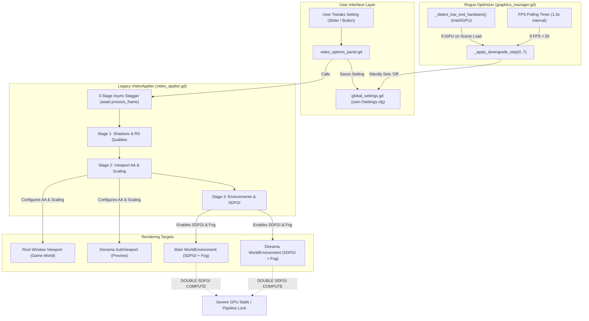
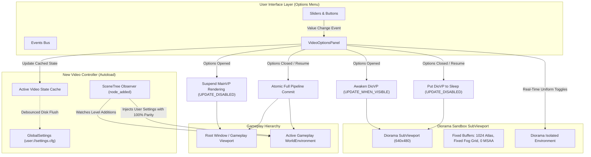
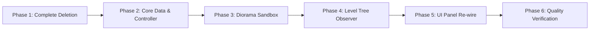

# Comprehensive Architectural Report: Video Settings Pipeline, Diorama Sandbox & Environment Management

**Target Developer**: Argon
**Project**: Bella Bittersweet: Tunnel Vision (`BellaSDK`)
**Scope**: Complete Ground-Up Rewrite of the Video Settings Pipeline, Diorama Preview System, and Environment Synchronization
**Constraint**: Architectural & Specification Report Only — Contains Zero Implementation Code

---

## 1. Executive Summary & Problem Statement

The graphics configuration system in `BellaSDK` suffers from severe framerate collapse, GPU pipeline stalls, visual state desynchronization between menus and gameplay levels, and persistent corruption of user configuration files.

When players adjust visual settings in the Options Menu, framerate drops precipitously—frequently exhibiting the signature compute characteristics of **two concurrent Signed Distance Field Global Illumination (SDFGI) cascades** running in tandem. Furthermore, volumetric fog and SDFGI frequently fail to appear in gameplay levels despite being explicitly enabled in menus, raw test scenes (such as `vistest_game.tscn`) drop to degraded visual tiers, and the custom title typography (*Kramola*) intermittently gets replaced by Godot's built-in engine font.

This report serves as the complete technical audit and architectural specification for **Argon** to discard the existing legacy code entirely and construct a clean, modern, event-driven video settings pipeline from scratch.

### Key Rewrite Objectives
1. **Rock-Solid 60 FPS Menu & Diorama Performance**: Eliminate all GPU stalls and buffer reallocation freezes when adjusting sliders or toggling settings in the UI.
2. **Strict Viewport Isolation**: Enforce a strict single-active-viewport rule ensuring that SDFGI cascades, volumetric fog voxel grids, and shadow depth atlases are never computed simultaneously on both the background world and the preview diorama.
3. **Deterministic Gameplay Parity**: Ensure that every level loaded—whether via the main menu, loading screen, or launched directly from the editor—automatically inherits the player's saved visual configuration with 100% fidelity.
4. **Permanent Purge of the Auto-Optimizer**: Completely eradicate the hidden low-end GPU sniffer, framerate polling loops, and automatic setting downgrade ladders that silently overwrite user preferences.
5. **Architectural Minimalism**: Build the entire rewrite using native Godot 4 C++ primitives (`Viewport`, `WorldEnvironment`, `Environment`, `RenderingServer`, `DisplayServer`, `ConfigFile`), avoiding custom polling timers, fragile multi-frame `await` chains, and speculative wrapper classes.

---

## 2. Existing System Architecture & Root Cause Audit

### 2.1 File & Responsibility Breakdown

The legacy video settings architecture is distributed across eight distinct scripts and scenes:

* [`ui/video_config.gd`](file:///home/dkd/Documents/BellaSDK/ui/video_config.gd): Declarative dictionary registry defining quality presets (*Low*, *Medium*, *High*, *Ultra*), mode mappings, and fallback defaults.
* [`ui/video_applier.gd`](file:///home/dkd/Documents/BellaSDK/ui/video_applier.gd): A static coordinator responsible for applying window properties, engine limits, shadow atlases, viewport anti-aliasing, and environment passes.
* [`ui/video_options_panel.gd`](file:///home/dkd/Documents/BellaSDK/ui/video_options_panel.gd): The primary graphics UI coordinator managing sub-sections:
  * [`ui/display_section.gd`](file:///home/dkd/Documents/BellaSDK/ui/display_section.gd): Window mode, display resolution, monitor selection, VSync, and framerate limit.
  * [`ui/quality_section.gd`](file:///home/dkd/Documents/BellaSDK/ui/quality_section.gd): Master presets, shadow quality, shadow filtering, distances, FSR 2 scaling, and mesh LOD.
  * [`ui/effects_section.gd`](file:///home/dkd/Documents/BellaSDK/ui/effects_section.gd): Tonemapping, exposure, debanding, DoF, motion blur, SSAO, SSIL, SSR, SDFGI, volumetric fog, and glow.
  * [`ui/hardware_section.gd`](file:///home/dkd/Documents/BellaSDK/ui/hardware_section.gd): GPU adapter detection, backend renderer selection, and the automated 60 FPS benchmark button.
* [`ui/options_router.gd`](file:///home/dkd/Documents/BellaSDK/ui/options_router.gd): Manages the category tabs (*Video*, *Audio*, *Gameplay*, *Controls*, *Accessibility*) and hosts the `DioramaViewport` SubViewport, routing the resulting `ViewportTexture` to a `TextureRect` inside the active panel.
* [`ui/main_menu.gd`](file:///home/dkd/Documents/BellaSDK/ui/main_menu.gd): Controls title screen state and pause menu overlays, attempting to put the diorama to sleep when returning to the main menu.
* [`player/settings_level.tscn`](file:///home/dkd/Documents/BellaSDK/player/settings_level.tscn): A dedicated 3D scene containing modular architectural assets, lighting, and preview cameras instantiated inside the `DioramaViewport`.
* [`ui/loading_screen_anim.gd`](file:///home/dkd/Documents/BellaSDK/ui/loading_screen_anim.gd): Re-applies active video settings during scene transitions.
* [`core/graphics_manager.gd`](file:///home/dkd/Documents/BellaSDK/core/graphics_manager.gd): The rogue "optimizer" autoload containing low-end GPU detection, runtime FPS polling, and destructive downgrade cascades.
* [`core/global_settings.gd`](file:///home/dkd/Documents/BellaSDK/core/global_settings.gd): Disk persistence layer writing key-value settings to `user://settings.cfg`.

---

### 2.2 Legacy Data & Execution Flow

---

### 2.3 Detailed Root Cause Analysis of Flaws

#### Root Cause 1: Two Concurrent SDFGI & Volumetric Fog Cascades
* **Mechanism**: In `video_applier.gd`'s `_apply_environment_and_materials()`, the script collects all environment resources in the tree. It populates an array called `main_environments` (which pulls the environment from `tree.root.find_world_3d().environment` and any active gameplay `WorldEnvironment`) and a separate array called `diorama_environments` (which pulls the environment from `DioramaViewport.find_world_3d().environment`).
* **The Glitch**: The method iterates through both lists and enables SDFGI and volumetric fog on **both simultaneously**.
* **Engine Consequence**: In Godot 4 Forward+ (Vulkan), SDFGI allocates a 3D cascade of signed distance fields and executes compute shader raymarching per environment. When both the gameplay world and the diorama SubViewport have SDFGI active, the GPU compute queue is forced to process **two independent cascade grids** and **two independent 3D volumetric fog voxel textures** in the same frame. This causes an instantaneous 40–60% framerate collapse.

#### Root Cause 2: Vulkan Pipeline Rebuilds & The Fragile 3-Frame Stagger
* **Mechanism**: Changing properties such as positional shadow atlas size (e.g. 1024 to 4096), directional shadow atlas size, volumetric fog slice depth, or MSAA requires Vulkan to destroy existing GPU depth textures, reallocate framebuffers, and recreate graphics pipelines.
* **The Flawed Fix**: The legacy code attempted to prevent Vulkan pipeline stalls by staggering execution across 3 frames using `await tree.process_frame` in `apply_viewport_pipeline()`.
* **The Failure**: When a player drags a slider or rapidly clicks through buttons, each signal triggers `apply_viewport_pipeline()`. A monotonic execution token (`_pipeline_run_id`) aborts prior passes midway through the 3-frame chain. If Stage 1 runs (allocating a new shadow atlas) but Stage 2 or 3 is aborted by a subsequent input, the rendering pipeline is left in an inconsistent, half-initialized state.

#### Root Cause 3: The Rogue "Optimizer" in `GraphicsManager`
* **Mechanism**: Located in [`core/graphics_manager.gd`](file:///home/dkd/Documents/BellaSDK/core/graphics_manager.gd), this autoload maintains two destructive behaviors:
  1. **Hardware Sniffing**: In `_detect_low_end_hardware()`, it inspects the string returned by `RenderingServer.get_video_adapter_name()`. If the adapter type is `DEVICE_TYPE_INTEGRATED_GPU` or the name contains `"intel"`, `_is_low_end` is flagged as `true`.
  2. **Level-Load Stripping**: Whenever a `WorldEnvironment` is added to the scene tree (`_on_node_added`), if `_is_low_end` is true, it immediately calls `_fast_forward_downgrades(MAX_DOWNGRADE_LEVEL)`.
  3. **FPS Polling Loop**: A 1.5-second timer (`_fps_timer`) continually monitors `Engine.get_frames_per_second()`. If FPS dips below 55 for two consecutive samples, it steps down quality.
* **The Failure**: The downgrade steps explicitly call `GlobalSettings.save_setting("Settings", "sdfgi", "Off")` and `save_setting("Settings", "volumetric_fog", "Off")`. This silently mutates the player's saved preferences on disk. When testing on secondary cards or laptops with switchable graphics, the game permanently strips settings down to minimum without player consent.

#### Root Cause 4: SDFGI and Fog Silently Disabled in Gameplay
* **Mechanism**: In [`ui/loading_screen_anim.gd`](file:///home/dkd/Documents/BellaSDK/ui/loading_screen_anim.gd), lines 426–431 explicitly mutate the active dictionary: `user_sdfgi_dict["enabled"] = false` before passing the configuration payload to `VideoApplier`. The script intended to re-enable SDFGI smoothly after level instantiation, but only did so if `_find_world_environment()` found the node.
* **The Failure**: In scenes where `WorldEnvironment` was nested under deep hierarchy nodes, or whenever scenes were launched directly without passing through `loading_screen_anim.gd` (e.g. hitting F6 on `vistest_game.tscn`), SDFGI remained permanently disabled. Furthermore, `vistest_game.tscn` defines an embedded `Environment` resource that defaults both SDFGI and volumetric fog to `false`. Without an automated observer, direct scene launches never received global settings.

#### Root Cause 5: Kramola Font Clobbering
* **Mechanism**: In [`core/global_settings.gd`](file:///home/dkd/Documents/BellaSDK/core/global_settings.gd), `FONT_REGISTRY` registers fonts in an indexed array:
  * Index 0: `{"id": "default", "name": "Default", "path": ""}`
  * Index 4: `{"id": "kramola", "name": "Kramola", "path": "res://assets/fonts/kramola/Kramola.otf"}`
* **The Failure**: `_apply_boot_settings()` reads `get_setting("Settings", "font_mode", 0)`. When no settings file exists or settings reset, index 0 is fetched. In [`core/events.gd`](file:///home/dkd/Documents/BellaSDK/core/events.gd), `_on_font_changed("default")` falls back to `ThemeDB.fallback_font` (Godot's default engine font). It then performs a recursive crawl over `root_window` and replaces the font across every UI control, wiping out the Kramola font defined in `main_theme.tres`.

---

## 3. Complete Catalog of Graphics Settings

This section documents every visual setting required in the game, its valid values, its default configuration, and its underlying Godot 4 engine target.

### 3.1 Display & Window Architecture

| Setting Identifier | Valid Values / Range | Default | Target Engine API / Node |
| :--- | :--- | :--- | :--- |
| **Display Mode** | Fullscreen, Borderless Windowed, Windowed | Borderless Windowed | `DisplayServer.window_set_mode()` / `Window.mode` |
| **Active Monitor** | Integer screen indices (0 to N) | 0 (Primary) | `Window.current_screen` |
| **Resolution** | 1920x1080 down to 640x480 | Native Window Size | `Window.content_scale_size` / `Window.size` |
| **VSync Mode** | Disabled, Enabled, Adaptive | Enabled | `DisplayServer.window_set_vsync_mode()` |
| **Framerate Cap** | 30, 40, 60, 90, 120, 144, 0 (Unlimited) | 60 FPS | `Engine.max_fps` |
| **UI Scale** | 0.75x to 1.5x | 1.0x | `Window.content_scale_factor` |

---

### 3.2 Viewport Quality, Scaling & Anti-Aliasing

| Setting Identifier | Valid Values / Range | Default | Target Engine API / Node |
| :--- | :--- | :--- | :--- |
| **Scaling Mode & 3D Scale** | Native (1.0), Quality (0.77), Balanced (0.59), Performance (0.50) | Native (1.0) | `Viewport.scaling_3d_mode = FSR2` / `Viewport.scaling_3d_scale` |
| **Anti-Aliasing (AA)** | Disabled, FXAA, TAA, TAA+FXAA, MSAA 2x, MSAA 4x, MSAA 8x | TAA (Smooth) | `Viewport.msaa_3d`, `Viewport.use_taa`, `Viewport.screen_space_aa` |
| **Variable Rate Shading (VRS)** | Disabled, Texture (Radial Density) | Disabled | `Viewport.vrs_mode`, `Viewport.vrs_texture` |
| **Occlusion Culling** | Enabled, Disabled (Boolean) | Enabled | `Viewport.use_occlusion_culling` |
| **Mesh LOD Threshold** | 1.0 (High detail) to 32.0 (Aggressive culling) | 1.0 | `Viewport.mesh_lod_threshold` |
| **Color Debanding** | Enabled, Disabled (Boolean) | Enabled | `Viewport.use_debanding` |
| **Texture Filtering** | Nearest, Linear, Linear Mipmap, Nearest Mipmap | Linear Mipmap | `Viewport.canvas_item_default_texture_filter` |
| **Anisotropic Filtering** | Disabled, 2x, 4x, 8x, 16x | 4x | `ProjectSettings: rendering/textures/default_filters/anisotropic_filtering_level` |

---

### 3.3 Lighting & Shadow Subsystem

| Setting Identifier | Valid Values / Range | Default | Target Engine API / Node |
| :--- | :--- | :--- | :--- |
| **Shadow Quality** | Off (0), Low (1024), Medium (2048), High (4096) | High (4096) | `Viewport.positional_shadow_atlas_size` |
| **Directional Atlas** | 1024, 2048, 4096 | 4096 | `RenderingServer.directional_shadow_atlas_set_size()` |
| **Shadow Filtering** | Hard (Fast), Soft Low, Soft Medium, Soft High | Soft Medium | `RenderingServer.positional_soft_shadow_filter_set_quality()` |
| **Dynamic Shadows** | Enabled, Disabled (Boolean) | Enabled | `Light3D.shadow_enabled` |
| **Positional Shadow Distance** | 16.0m to 40.0m | 32.0m | `Light3D.distance_fade_shadow` |
| **Directional Shadow Distance** | 32.0m to 80.0m | 64.0m | `DirectionalLight3D.directional_shadow_max_distance` |

---

### 3.4 Environment & Post-Processing Effects

| Setting Identifier | Valid Values / Range | Default | Target Engine API / Node |
| :--- | :--- | :--- | :--- |
| **Tonemapping Mode** | Linear, Reinhard, Filmic, ACES, AgX | Filmic | `Environment.tonemap_mode` |
| **Exposure** | 0.5 to 2.0 | 1.0 | `Environment.tonemap_exposure` |
| **SSAO** | Off, Low, Medium, High | Medium | `Environment.ssao_enabled`, `RenderingServer.environment_set_ssao_quality()` |
| **SSIL** | Off, Low, Medium, High | Off | `Environment.ssil_enabled`, `RenderingServer.environment_set_ssil_quality()` |
| **SSR** | Off, Low (32), Medium (64), High (128) | Off | `Environment.ssr_enabled`, `Environment.ssr_max_steps` |
| **SDFGI** | Off, Low (2 cascades), Med (3), High (4) | Off | `Environment.sdfgi_enabled`, `Environment.sdfgi_cascades` |
| **Volumetric Fog** | Off, Low (depth 64), Med (96), High (128) | Off | `Environment.volumetric_fog_enabled`, `RenderingServer.environment_set_volumetric_fog_volume_size()` |
| **Glow / Bloom** | Off, Low, Medium, High (Bicubic) | High | `Environment.glow_enabled`, `Environment.glow_blend_mode` |
| **Depth of Field (DoF)** | Enabled/Disabled, Amount (0.0 to 0.5) | Disabled | `CameraAttributesPractical.dof_blur_far_enabled`, `dof_blur_amount` |
| **Camera Motion Blur** | 0.0 to 1.5 | 0.0 | Extended Camera property / post-process pass |

---

### 3.5 Master Presets Definition Matrix

| Feature | Low Preset | Medium Preset | High Preset (Default) | Ultra Preset |
| :--- | :--- | :--- | :--- | :--- |
| **Shadow Quality** | Low (1024) | Medium (2048) | High (4096) | High (4096) |
| **Dynamic Shadows** | Disabled | Enabled | Enabled | Enabled |
| **Shadow Filter** | Hard (Fast) | Soft Low | Soft Medium | Soft High |
| **Positional Shadow Dist** | 16.0m | 24.0m | 32.0m | 40.0m |
| **Directional Shadow Dist** | 32.0m | 48.0m | 64.0m | 80.0m |
| **FSR 2 Scale** | 0.70x | 1.0x (Native) | 1.0x (Native) | 1.0x (Native) |
| **Mesh LOD Threshold** | 32.0 | 16.0 | 4.0 | 1.0 |
| **SSAO** | Off | Low | Medium | High |
| **SSIL** | Off | Off | Low | Medium |
| **SSR** | Off | Off | Low | Medium |
| **SDFGI** | Off | Off | Low (2 cascades) | Medium (3 cascades) |
| **Volumetric Fog** | Off | Off | Off | Medium (depth 96) |
| **Glow** | Off | Low | High | High |
| **Motion Blur** | 0.0 | 0.25 | 0.50 | 0.75 |
| **Depth of Field** | Disabled | Disabled | Enabled (0.15) | Enabled (0.15) |

---

## 4. Target Architecture & Clean-Slate Specification

Argon must replace the existing multi-class spaghetti with an **asymmetric, isolated pipeline** separating the interactive menu diorama sandbox from the active gameplay world.

---

### 4.1 Component Contracts for Argon

#### 1. Central Video Controller (Autoload)
* **Role**: Single source of truth for runtime graphics settings and persistent configuration. Replaces `VideoApplier` and `GraphicsManager`.
* **State Management**:
  * Stores normalized active dictionary representing the player's choices.
  * Defaults strictly to the static `"High"` preset on first launch or when the user invokes "Reset to Defaults".
  * Completely removes all GPU model detection strings, vendor heuristic parsing, and dynamic framerate timers.
* **Level Parity (SceneTree Observer)**:
  * Hooks `get_tree().node_added`.
  * When any `WorldEnvironment` node enters the scene tree, it verifies whether the node is situated inside a diorama SubViewport. If it is a gameplay environment, the controller applies the full user settings payload immediately.
  * Guarantees that direct editor test launches (such as `vistest_game.tscn`) inherit correct SDFGI, volumetric fog, and tonemapping automatically.

#### 2. Diorama Sandbox Coordinator
* **Role**: Provides instantaneous visual feedback for settings adjustments inside the options menu without stalling the engine.
* **Viewport Isolation Protocol**:
  * When the options menu opens (from either title screen or mid-game pause), the coordinator instructs the primary gameplay viewport to set `render_target_update_mode = UPDATE_DISABLED`.
  * The `DioramaViewport` is set to `render_target_update_mode = UPDATE_WHEN_VISIBLE` and `process_mode = PROCESS_MODE_ALWAYS`.
  * **Zero Dual-GI Guarantee**: At no point in the lifecycle are both viewports rendering simultaneously. SDFGI and volumetric fog run exclusively in the diorama while the menu is active.
* **Fixed Buffer Allocations (No Reallocation Hiccups)**:
  * The diorama SubViewport must never execute buffer resizing. Its shadow atlas is locked to 1024, its fog volume grid depth is locked to 64, and its MSAA is locked to Disabled.
  * Settings adjustments (enabling SDFGI, toggling fog on/off, adjusting density, changing exposure, switching tonemappers, adjusting SSAO/SSR) apply strictly as **runtime shader uniform updates and environment property assignments**.
  * Eliminates the need for any multi-frame `await process_frame` stagger. Changes take effect synchronously on the very next frame.
* **Dormant Sleep Lifecycle**:
  * When the player exits options or clicks resume, `DioramaViewport` is set to `render_target_update_mode = UPDATE_DISABLED` and `process_mode = PROCESS_MODE_DISABLED`.
  * The diorama level remains dormant in the tree to eliminate reload latency, but draws zero milliseconds of GPU render time during gameplay.
  * The gameplay viewport is restored, and settings (including heavy shadow atlases, FSR 2 scaling, and full-resolution SDFGI cascades) are committed atomically to the gameplay world.

#### 3. Typography Subsystem Refactor
* **Role**: Guarantees that *Kramola* is preserved as the game's canonical typeface.
* **Registry Re-indexing**:
  * In `FONT_REGISTRY`, index 0 is assigned directly to *Kramola* (`res://assets/fonts/kramola/Kramola.otf`).
  * Godot's built-in engine fallback font is removed from index 0.
  * When settings are uninitialized, reset, or missing from disk, index 0 resolves to Kramola.
  * `Events._on_font_changed` is refactored to verify font validity before applying overrides, ensuring it never clobbers `root_window.theme.default_font` with engine fallbacks.

---

## 5. Deletion & Implementation Roadmap for Argon

### Phase 1: Deletion Checklist
Argon must completely delete the following components before writing replacement code:
* **In `core/graphics_manager.gd`**:
  * Delete `_detect_low_end_hardware()` and `_is_low_end`.
  * Delete `_setup_fps_timer()`, `_on_fps_timer_timeout()`, and `_evaluate_runtime_performance()`.
  * Delete `_apply_downgrade_step()` and `_fast_forward_downgrades()`.
  * Delete `run_benchmark_for_60fps()`.
  * Delete `use_auto_optimizer` from all save dictionaries and configuration calls.
* **In `ui/hardware_section.gd`**:
  * Delete the Auto-Tune benchmark button and its signal bindings.
* **In `ui/video_options_panel.gd`**:
  * Delete `_disarm_auto_optimizer()`.
  * Delete `_on_auto_tune_requested()` and `_on_benchmark_completed()`.
* **In `ui/loading_screen_anim.gd`**:
  * Delete lines 426–431 that hardcode `user_sdfgi_dict["enabled"] = false`.
* **In `ui/video_applier.gd`**:
  * Deprecate and scrap the entire 3-stage `await tree.process_frame` pipeline.

### Phase 2: Core Controller & Declarative Config
* Implement a clean, declarative configuration module holding preset dictionaries, feature limits, and fallback defaults.
* Implement the unified video controller autoload responsible for:
  * Caching the active settings dictionary in memory.
  * Debounced disk persistence to `user://settings.cfg`.
  * Static `"High"` preset assignment on first boot and reset.

### Phase 3: Diorama Sandbox & Viewport Isolation
* Reconstruct `DioramaViewport` inside `OptionsMenu`:
  * Size locked to 640x480.
  * `own_world_3d = true` with a dedicated, isolated `World3D`.
  * Fixed internal buffer limits (1024 positional shadow atlas, fixed fog grid, disabled MSAA).
* Implement menu open/close hooks:
  * On Open: Freeze gameplay viewport rendering (`UPDATE_DISABLED`); activate diorama (`UPDATE_WHEN_VISIBLE`).
  * On Close: Deactivate diorama (`UPDATE_DISABLED` & `PROCESS_MODE_DISABLED`); restore gameplay viewport; push settings to gameplay world.
* Wire UI controls (sliders, toggles) directly to diorama environment properties for instant, zero-stutter visual feedback.

### Phase 4: Autoload SceneTree Observer & Level Parity
* Connect `get_tree().node_added` in the video controller:
  * Check if the added node is a `WorldEnvironment`.
  * Filter out preview diorama environments.
  * Automatically apply user video settings to the new level environment immediately.
* Verify that directly opening `vistest_game.tscn` from the editor instantly loads with full SDFGI, volumetric fog, and tonemapping.

### Phase 5: UI Panel Re-wiring & Typography Fix
* Re-index `FONT_REGISTRY` in `GlobalSettings` so *Kramola* is permanently registered at index 0.
* Reconnect all UI widgets in `DisplaySection`, `QualitySection`, and `EffectsSection` to the new controller via typed Callables.
* Ensure all signals disconnect cleanly in `_exit_tree()` per project guidelines.

---

## 6. Pre-Flight Verification & Acceptance Criteria

Argon's rewrite will be considered complete and successful only when all of the following verification criteria pass:

1. **Zero Double-SDFGI Invocations**:
   * Inspecting GPU compute queues while inside the options menu confirms that only **one** SDFGI cascade system is active (the diorama).
   * Framerate remains fluid at 60 FPS while switching tabs and adjusting effect tiers.
2. **Instantaneous Slider Response**:
   * Dragging the exposure, DoF, volumetric fog, or SDFGI sliders in the menu results in immediate, zero-stutter visual updates on the diorama model.
   * No multi-frame lag or half-applied visual glitches occur when rapidly toggling presets.
3. **Seamless Transition to Gameplay**:
   * Unpausing or starting a new game instantly suspends the diorama (0.0 ms render time) and applies user settings to the gameplay level without visual artifacts.
4. **Direct Level Launch Parity**:
   * Launching `vistest_game.tscn` directly via Godot's "Play Current Scene" (F6) immediately runs with user-configured SDFGI and volumetric fog.
5. **No Rogue Downgrades**:
   * Running the game on an integrated GPU or simulated low-FPS environment never alters `user://settings.cfg` or downgrades graphics settings behind the scenes.
6. **Typography Integrity**:
   * Resetting settings to defaults or booting with a deleted configuration file preserves *Kramola* across all menu headers, buttons, and dialog labels.

---
*Report compiled for Argon's BellaSDK Video Settings Overhaul.*
